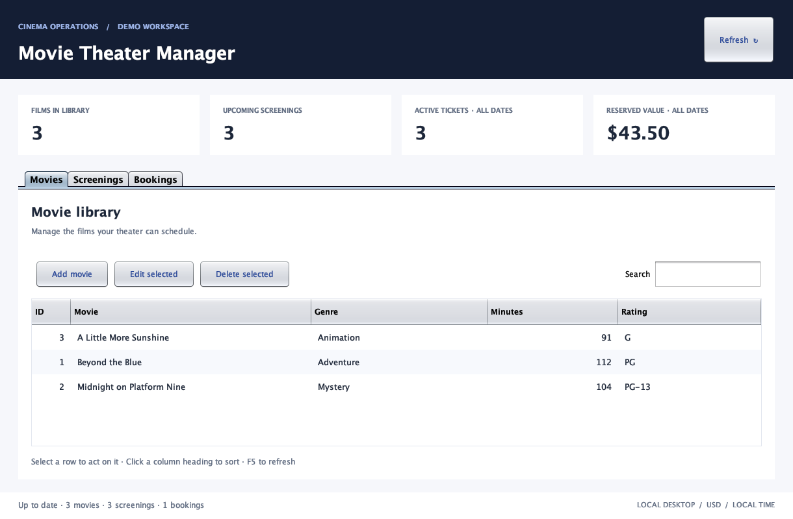
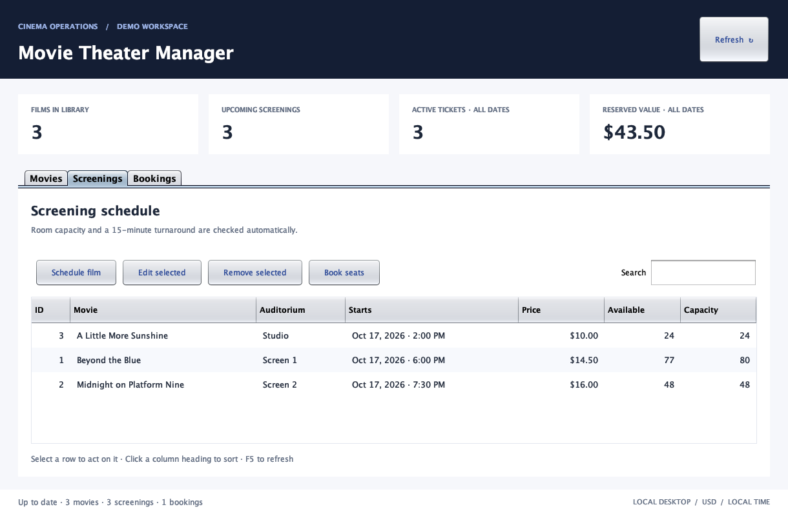
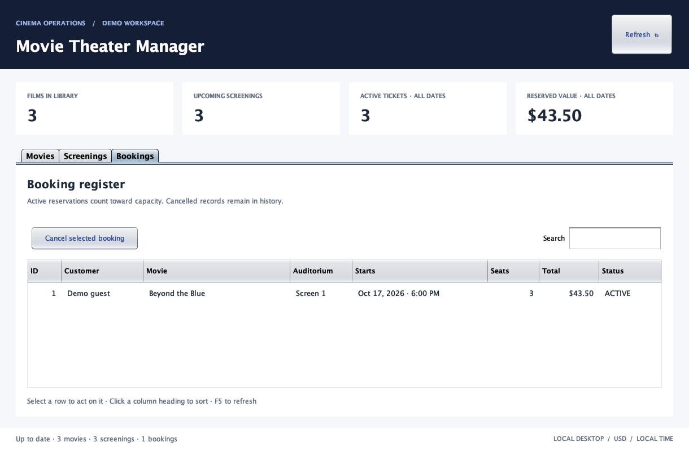

# Movie Theater Manager

A Java desktop application for managing a movie library, auditorium schedules, and seat reservations. Built with Swing, JDBC, and an embedded H2 database, it runs locally without a database server or account setup.

This project expands an earlier Java/MySQL classroom prototype into a usable desktop workflow. The fixed movie IDs, hardcoded database connection settings, console-only results, and bundled legacy connector jars have been replaced with interactive forms, persistent tables, and a reproducible Maven build.

## Preview







The previews use fictional demo data. The interface displays all dates in the computer's local time zone and all amounts in USD.

## Run the included application

Requires **Java 21 or newer** and a desktop environment. No MySQL installation is needed. Extract the complete ZIP before running it.

- **macOS:** open `demo.command` for the sample workspace, or `run.command` for an empty workspace. If the extracted script loses its executable permission, use `sh demo.command` in Terminal.
- **Windows:** open `demo.bat` or `run.bat`.
- **Linux or any terminal:** run either command below from this folder.

```sh
java -jar movie-theater-manager.jar --demo
java -jar movie-theater-manager.jar
```

The demo uses a separate database from the empty workspace. It creates three fictional movies, three future screenings, and one example reservation on its first run. Subsequent launches preserve changes; dates are not reset or moved forward automatically.

## Build from source

Requires a JDK 21+ and Maven 3.9+. Maven downloads dependencies on the first build.

```sh
mvn verify
java -jar target/movie-theater-manager-1.0.0.jar --demo
```

The packaged JAR includes H2. Swing is supplied by the JDK. CI builds and runs the tests on Java 21 for pushes and pull requests; the workflow is included but has not been run on GitHub yet.

## Use the application

1. In **Movies**, add a title, genre, duration, and rating. Select a row to edit or delete it.
2. In **Screenings**, schedule a movie in one of three auditoriums. Enter a local date such as `2027-05-20 18:30` and a price such as `14.50`.
3. Select a screening and choose **Book seats**. Enter a booking name and seat count; the form shows the reservation total.
4. In **Bookings**, select a reservation to cancel it. Seats are released, and the cancelled record remains visible.
5. Use **Search** to filter each table, column headings to sort, or **Refresh / F5** to reload the database.

A booking is a reservation only: the app does not collect payments, issue refunds, send email, or assign individual seat numbers. Dashboard totals show active tickets and their reserved value across all dates, including past screenings; cancelled reservations are excluded.

## Rules that protect the data

- A screening must start in the future; prices allow up to two decimal places.
- Films in the same auditorium cannot overlap. The schedule reserves 15 minutes after each film for turnaround.
- A reservation contains 1–20 seats. Capacity is checked inside a transaction with a screening-row lock, preventing simultaneous requests from overselling a room.
- Bookings and cancellations close at the screening start time.
- Screenings with any booking history cannot be edited or deleted, even after cancellation. This preserves the price and schedule associated with reservations.
- Movies with screenings cannot be deleted or have their running time changed. Titles, genres, and ratings can still be corrected; title changes also appear in existing booking lists.
- SQL values use prepared statements. Database resources close automatically, and database work runs outside Swing's event thread.

## Storage and configuration

By default, files are stored relative to the launch directory:

| Workspace | Database folder |
| --- | --- |
| Empty / normal | `data/live/` |
| Demo | `data/demo/` |

The launch scripts always use the application folder. A direct `java -jar` command uses the current directory. To choose a different storage folder:

```sh
java -Dcinema.dataDir=/path/to/my-theater -jar movie-theater-manager.jar
```

Close the app before backing up the complete data folder. Keep live data out of Git; `.gitignore` excludes database files. Only run one application instance against a given data folder. If startup reports the database is in use, close the other instance first.

This is a single-operator portfolio application. It does not include authentication, encryption at rest, multi-user deployment, or an audit log. Use fictional booking names when demonstrating it. The embedded database uses its local default account without an embedded personal credential; operating-system file permissions protect access. Do not publish your database files.

The previous MySQL schema and data are not imported. The original project remains separate; this version initializes a new local schema and uses synthetic data only.

## Tests

```sh
mvn test
java -jar movie-theater-manager.jar --demo --check
```

`--check` initializes or reopens the selected database, reports record counts, and exits without opening a window. Use `--help` for the launch options.

The test suite covers movie operations, validation, SQL text handling, schedule conflicts and turnaround boundaries, booking totals, capacity, concurrent reservations, concurrent schedules, cancellation, history protection, and persistence after reopening the database. Tests use isolated databases and a fixed clock; they do not connect to the original MySQL server.

See [architecture](docs/ARCHITECTURE.md) for the code structure and [validation](docs/VALIDATION.md) for the checks performed on this version.

## Project layout

```text
src/main/java/com/srashad/cinema/
  CinemaApp.java       Desktop startup and database selection
  CinemaPanel.java     Forms, tables, search, dashboard, background tasks
  CinemaService.java   Business rules, transactions, prepared statements
  Database.java        Connections, schema, reference auditoriums
  Models.java          Immutable records
  DemoData.java        Fictional, opt-in sample workspace
src/test/java/com/srashad/cinema/
  CinemaServiceTest.java
```

## Future improvements

- Numbered seat selection and a visual seating chart
- Configurable auditorium administration
- Reports and filtered exports
- Schema migrations for future releases
- Authentication and an audit log if expanded beyond local single-operator use

## Reuse

No open-source license has been selected. Choose a license before inviting reuse of the project; repository visibility alone does not grant unrestricted reuse rights.
