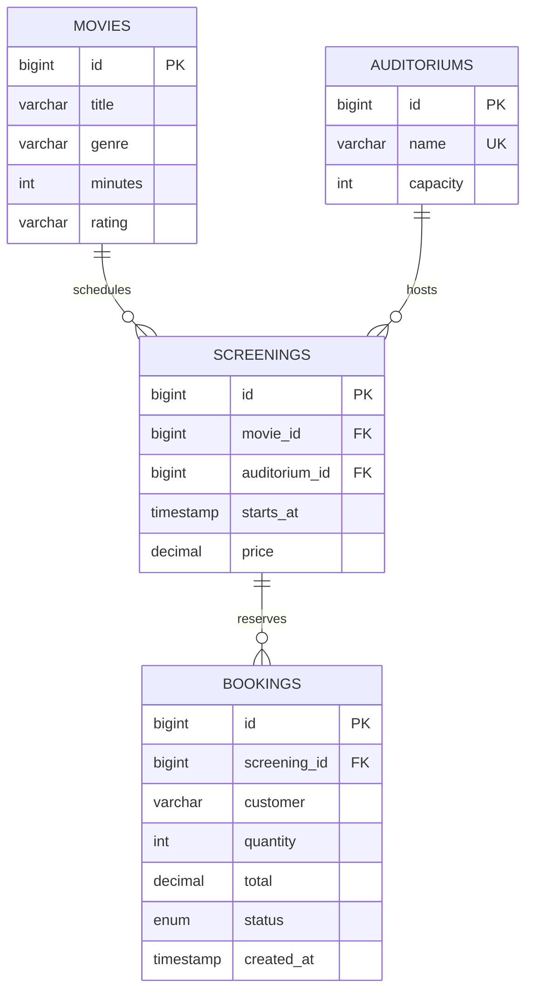

# Architecture

The desktop UI delegates all persistence and business decisions to `CinemaService`. `Database` creates short-lived JDBC connections and initializes the H2 schema. Immutable record objects in `Models` keep table data separate from live result sets.

## Data model

The database enforces foreign keys, positive capacities and quantities, nonnegative amounts, and the two booking states. A unique room/start pair is a final guard against duplicate screening slots. The service checks interval overlap, turnaround time, valid ratings, future dates, and remaining capacity.

## Transaction boundaries

Movie edits lock the movie record. Screening writes lock the selected movie and affected auditoriums in ascending ID order before checking conflicts. Booking and cancellation operations lock the screening before calculating or changing occupancy. The transaction commits only after its write succeeds; exceptions roll it back.

Each query and update uses try-with-resources. Generated identifiers come from database identity columns, not manually entered values. Currency values use `BigDecimal`; the reservation total is captured when booked rather than recalculated from a future ticket price.

## Presentation

Swing layout managers replace the original absolute coordinates. All database tasks use `SwingWorker`; the event dispatch thread owns the tables and forms. A busy guard prevents overlapping UI writes. Input dialogs validate basic date, price, and spinner formats, while the service repeats all business-rule validation independently of the UI. Table models retain typed dates, integers, and amounts so sorting uses values rather than formatted strings.

## Deliberate limits

The app is a local reservation tool with no payment processing or live website. Three reference auditoriums initialize idempotently; auditorium editing is not yet exposed. Scheduling uses local wall-clock time without time-zone conversion. There is no legacy MySQL migration, automatic data deletion, encryption, user access control, or production audit trail. Database changes for future releases should use explicit migrations rather than relying on `CREATE TABLE IF NOT EXISTS` to modify existing tables.
